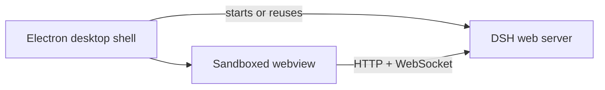

# DeepSeek Harness Desktop

[](https://github.com/ParkerLille/dsh-desktop/actions/workflows/ci.yml)
[](LICENSE)
[](#requirements)

A Windows desktop shell for [DeepSeek Harness](https://github.com/deepseek-ai/deepseek-harness). It embeds the complete `dsh web` experience in Electron without forking or replacing the upstream web application.

[简体中文](README.zh-CN.md)

> [!IMPORTANT]
> This is an independent community project, not an official DeepSeek product. DeepSeek and related names may be trademarks of their respective owners.

## Highlights

- **Full DSH experience**: conversations, streaming, model settings, files, tools, history, and client plugins remain provided by the upstream DSH web app.
- **Managed local runtime**: reuses an existing DSH server on `127.0.0.1:3080` or starts the bundled CLI and waits for readiness.
- **Desktop isolation**: context isolation, renderer sandboxing, restricted navigation, and no Node.js API exposed to the guest page.
- **Reproducible Windows packaging**: an NSIS build script downloads pinned archives and verifies their SHA-256 checksums.
- **Tested recovery tooling**: includes a guarded command for one known interrupted-session replay corruption pattern.

## Project status

`v0.1.0` is the first public release. The application is usable on Windows, but it is still early-stage software. Installers are currently unsigned and automatic updates are not implemented.

## Requirements

- Windows 10 or Windows 11, x64
- [Node.js](https://nodejs.org/) 24 or newer
- [pnpm](https://pnpm.io/) 11 or newer
- A model provider configured through DeepSeek Harness

## Build from source

`pnpm install` runs the repository's normal dependency installation. No API keys or credentials belong in this repository; configure providers from the DSH settings UI.

```powershell
git clone https://github.com/ParkerLille/dsh-desktop.git
cd dsh-desktop
pnpm install --frozen-lockfile
pnpm test
pnpm typecheck
pnpm dev
```

### Production build

```powershell
pnpm build
```

### Windows installer

```powershell
pnpm dist:win
```

Unsigned NSIS artifacts are written to `release/`. The packaging script caches verified NSIS archives under `.cache/`. The packaged app deliberately uses a real `resources/app` directory rather than ASAR because DSH profile dependencies use Windows filesystem junctions.

## How it works



| Area | Responsibility |
| --- | --- |
| `src/main` | Electron lifecycle, DSH process management, IPC |
| `src/preload` | Narrow context-isolated desktop bridge |
| `src/renderer` | Webview host |
| `src/shared` | IPC contracts |
| `tests` | Process, packaging, UI, and recovery regression tests |

The shell keeps the original DSH origin and boot path. It does not proxy or reimplement the DSH frontend.

## Configuration

| Variable | Purpose | Default |
| --- | --- | --- |
| `DSH_DESKTOP_URL` | DSH web URL loaded by the desktop shell | `http://127.0.0.1:3080` |
| `DSH_DESKTOP_COMMAND` | External DSH executable used instead of the bundled CLI | bundled Electron Node runtime |

Do not run multiple DSH servers against the same session storage while opening the same session. The default setup reuses the server already listening on port `3080`.

## Privacy and trust boundaries

The desktop shell does not add its own analytics. The bundled DeepSeek Harness dependencies may have their own telemetry and provider behavior; review the [upstream project](https://github.com/deepseek-ai/deepseek-harness) and your DSH settings before use. Conversations, credentials, and session data remain local to the DSH and desktop user-data directories unless an upstream provider or feature transmits them.

Treat `DSH_DESKTOP_URL` as a trusted endpoint. The desktop currently checks that the URL responds, but it does not cryptographically authenticate the service listening there.

## Troubleshooting

Desktop startup failures are appended to `%APPDATA%/dsh-desktop/desktop.log`.

If port `3080` is occupied by an unrelated service, stop that service or set `DSH_DESKTOP_URL` to an appropriate DSH endpoint. If a session reports the exact interrupted replay sequence-overlap corruption described by the repair command, run a dry analysis before applying any change:

```powershell
pnpm repair:session <path-to-session.jsonl.zstd>
pnpm repair:session <path-to-session.jsonl.zstd> --apply
```

The apply mode creates a timestamped backup and refuses logs that do not match the narrowly validated repair pattern.

## Contributing

Issues and pull requests are welcome. Read [CONTRIBUTING.md](CONTRIBUTING.md), [SECURITY.md](SECURITY.md), and the [Code of Conduct](CODE_OF_CONDUCT.md) before contributing.

## License

Released under the [MIT License](LICENSE).
