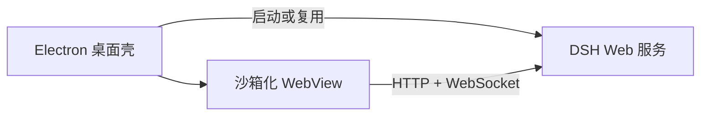

# DeepSeek Harness Desktop

[](https://github.com/ParkerLille/dsh-desktop/actions/workflows/ci.yml)
[](LICENSE)
[](#运行要求)

这是一个面向 [DeepSeek Harness](https://github.com/deepseek-ai/deepseek-harness) 的 Windows 桌面客户端。它通过 Electron 嵌入完整的 `dsh web`，并且不修改、不复制上游 Web 应用。

[English](README.md)

> [!IMPORTANT]
> 这是独立的社区项目，不是 DeepSeek 官方产品。DeepSeek 及相关名称可能是其各自权利人的商标。

## 主要能力

- **完整保留 DSH 功能**：对话、流式输出、模型设置、文件、工具、历史记录和客户端插件仍由上游 DSH Web 应用提供。
- **托管本地运行时**：优先复用 `127.0.0.1:3080` 上已有的 DSH 服务，否则启动安装包内置 CLI 并等待服务就绪。
- **桌面安全边界**：启用上下文隔离、渲染器沙箱、导航来源限制，不向 guest 页面暴露 Node.js API。
- **可复现 Windows 打包**：NSIS 脚本使用固定版本归档并校验 SHA-256。
- **受保护的会话修复工具**：针对一种已知的“中断后旧响应重放”日志损坏提供严格匹配、先备份后修改的修复命令。

## 项目状态

`v0.1.0` 是第一个公开版本。目前 Windows 桌面端已经可用，但仍属于早期阶段：安装包尚未进行代码签名，没有自动更新能力。

## 运行要求

- Windows 10 或 Windows 11，x64
- Node.js 24 或更高版本
- pnpm 11 或更高版本
- 已在 DeepSeek Harness 中配置可用的模型提供方

## 从源码运行

API Key 和模型凭据不应写入本仓库，请在 DSH 设置界面中配置。

```powershell
git clone https://github.com/ParkerLille/dsh-desktop.git
cd dsh-desktop
pnpm install --frozen-lockfile
pnpm test
pnpm typecheck
pnpm dev
```

构建生产资源：

```powershell
pnpm build
```

生成 Windows 安装包：

```powershell
pnpm dist:win
```

未签名的 NSIS 产物会写入 `release/`。打包脚本会把已校验的 NSIS 归档缓存到 `.cache/`。应用有意不使用 ASAR，因为 DSH profile 的依赖闭包需要使用 Windows 文件系统 junction。

## 架构



| 目录 | 职责 |
| --- | --- |
| `src/main` | Electron 生命周期、DSH 进程管理、IPC |
| `src/preload` | 最小化、上下文隔离的桌面桥接层 |
| `src/renderer` | WebView 宿主 |
| `src/shared` | IPC 契约 |
| `tests` | 进程、打包、UI 和会话修复回归测试 |

桌面壳保留 DSH 原有来源、启动注入、HTTP API 和 WebSocket，不代理或重写 DSH 前端。

## 环境变量

| 变量 | 用途 | 默认值 |
| --- | --- | --- |
| `DSH_DESKTOP_URL` | 桌面端加载的 DSH Web 地址 | `http://127.0.0.1:3080` |
| `DSH_DESKTOP_COMMAND` | 使用外部 DSH 命令替代安装包内置 CLI | Electron Node 运行时 |

不要让多个 DSH 服务共享同一会话存储并同时打开同一个会话。默认配置会复用已监听 `3080` 的服务。

## 隐私与信任边界

桌面壳本身不增加分析统计。安装包内的 DeepSeek Harness 依赖可能有自己的遥测与模型提供方行为，使用前请查阅[上游项目](https://github.com/deepseek-ai/deepseek-harness)并检查 DSH 设置。对话、凭据和会话数据默认保存在 DSH 与桌面端用户数据目录中，但上游模型提供方或功能可能会传输相关内容。

请把 `DSH_DESKTOP_URL` 视为受信任端点。桌面端目前会检查 URL 是否响应，但不会对监听该地址的服务做密码学身份认证。

## 故障排查

桌面启动失败会追加记录到 `%APPDATA%/dsh-desktop/desktop.log`。

如果 `3080` 被无关服务占用，请停止该服务或把 `DSH_DESKTOP_URL` 指向正确的 DSH 地址。会话修复命令只处理一种严格识别的中断重放损坏，必须先 dry-run：

```powershell
pnpm repair:session <session.jsonl.zstd 路径>
pnpm repair:session <session.jsonl.zstd 路径> --apply
```

应用模式会先创建时间戳备份；不符合目标模式的日志会被拒绝修改。

## 参与贡献

欢迎提交 Issue 和 Pull Request。参与前请阅读 [贡献指南](CONTRIBUTING.md)、[安全策略](SECURITY.md)和[社区行为准则](CODE_OF_CONDUCT.md)。

## 许可证

本项目使用 [MIT License](LICENSE)。
